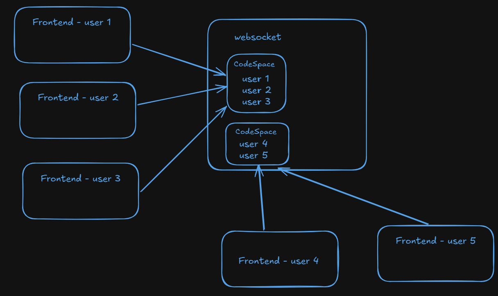
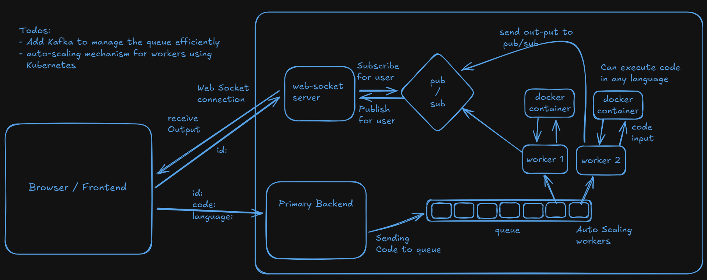
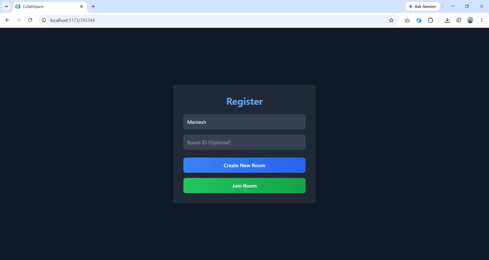
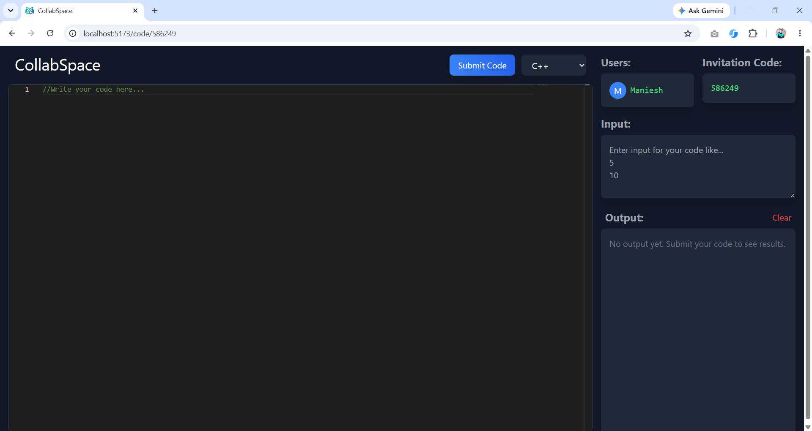
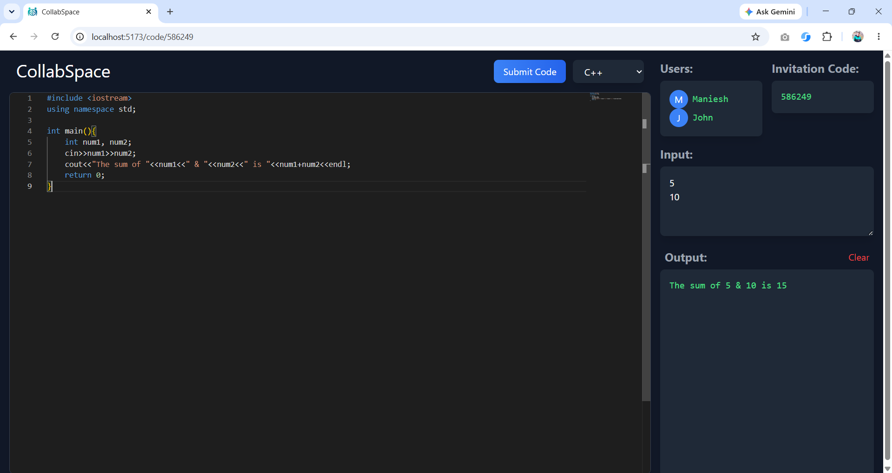

<h1 align="center">
  🚀 CollabSpace — Real-Time Collaborative Code Editor
</h1>

<p align="center">
  A production-grade, real-time collaborative coding platform where developers can write, run, and share code together — live.
</p>

<p align="center">
  
  
  
  
  
  
</p>

---

## ✨ Features

- 🔴 **Real-time collaboration** — Multiple users edit the same code simultaneously with live cursor tracking
- 🐳 **Sandboxed code execution** — User-submitted code runs in isolated Docker containers (no host access)
- 🌐 **Multi-language support** — C++, Python, JavaScript, Java, Go, Rust
- ⚡ **Async job queue** — Submissions are queued via Redis and processed by a scalable worker cluster
- 📡 **Pub/Sub result delivery** — Execution results are streamed back in real-time via Redis pub/sub → WebSocket
- 🔒 **Resource-limited containers** — Each execution is capped at 256MB RAM, 1 CPU, and 100 PIDs
- 🏠 **Room-based sessions** — Users join shared rooms via 6-digit invitation codes

---

## 🏗️ System Architecture

### Collaborative Editor Architecture


### Code Compilation Pipeline


---

## 🛠️ Tech Stack

| Layer | Technology | Purpose |
|---|---|---|
| **Frontend** | React, TypeScript, Vite, CodeMirror | Real-time collaborative UI |
| **API Server** | Node.js, Express | Receives code submissions, enqueues jobs |
| **WebSocket Server** | Node.js, `ws` | Syncs code, cursor, and output in real-time |
| **Worker** | Node.js, Cluster API | Consumes job queue, orchestrates Docker execution |
| **Message Broker** | Redis (List + Pub/Sub) | Job queue + result broadcast channel |
| **Code Sandbox** | Docker | Isolated, resource-limited execution environment |
| **Monorepo** | Turborepo, npm workspaces | Unified build pipeline across 4 services |

---

## 📐 How It Works

```
User submits code
      │
      ▼
Express Server  ──── lPush ────▶  Redis Queue ("problems")
                                        │
                                        │  brPop (blocking)
                                        ▼
                                  Worker (Cluster)
                                        │
                          docker run --rm --memory=256m ...
                                        │
                                   stdout/stderr
                                        │
                                  Redis Publish(roomId, result)
                                        │
                                        ▼
                              WebSocket Server (subscribed)
                                        │
                                  ws.send(output)
                                        │
                                        ▼
                                  User's Browser
```

**Key design decisions:**
- **Worker uses Node.js Cluster** — spawns 3 worker processes to handle concurrent submissions without blocking
- **Redis as message broker** — decouples the API from execution; the queue absorbs traffic spikes
- **Docker-per-submission** — each run is a fresh, isolated container that is destroyed after execution, preventing state leakage between users

---

## 🖥️ Demo





---

## 🚀 Getting Started

### Prerequisites
- [Node.js](https://nodejs.org/) v18+
- [Docker Desktop](https://www.docker.com/products/docker-desktop/)
- npm v10+

### 1. Clone the repository
```bash
git clone https://github.com/YOUR_USERNAME/real-time-collab-editor.git
cd real-time-collab-editor
```

### 2. Install all dependencies
```bash
npm install
```

### 3. Start Redis via Docker
```bash
docker-compose up -d
```

### 4. Run all services in development mode
```bash
npm run dev
```

This starts all 4 services concurrently via **Turborepo**:

| Service | URL | Description |
|---|---|---|
| Frontend | http://localhost:5173 | React UI |
| Express API | http://localhost:3000 | REST submission endpoint |
| WebSocket Server | ws://localhost:5000 | Real-time sync |
| Worker | — | Background job processor |

### 5. Pre-pull Docker execution images (optional but recommended)
```bash
docker pull gcc:11
docker pull node:18
docker pull python:3.9
docker pull openjdk:17
docker pull golang:1.18
```

---

## 📁 Project Structure

```
real-time-collaborative-code-editor/
├── apps/
│   ├── frontend/          # React + Vite (TypeScript)
│   ├── express-server/    # REST API — job submission
│   ├── websocket-server/  # WebSocket — real-time sync
│   └── worker/            # Job consumer + Docker execution
├── packages/
│   ├── eslint-config/     # Shared ESLint config
│   └── typescript-config/ # Shared TypeScript config
├── docker-compose.yml     # Redis container
└── turbo.json             # Turborepo pipeline config
```

---

## 🌍 Deployment

The app is designed for deployment on a VPS (e.g. AWS EC2) where Docker is available on the host — required for the sandboxed code execution feature.

**Quick deploy to AWS EC2 (free tier):**
1. Launch a `t2.micro` Ubuntu instance
2. Install Node.js 18, Docker, Nginx, and PM2
3. Clone the repo, build TypeScript, and start services with `pm2`
4. Configure Nginx as a reverse proxy for all services

---

## 📄 License

MIT
